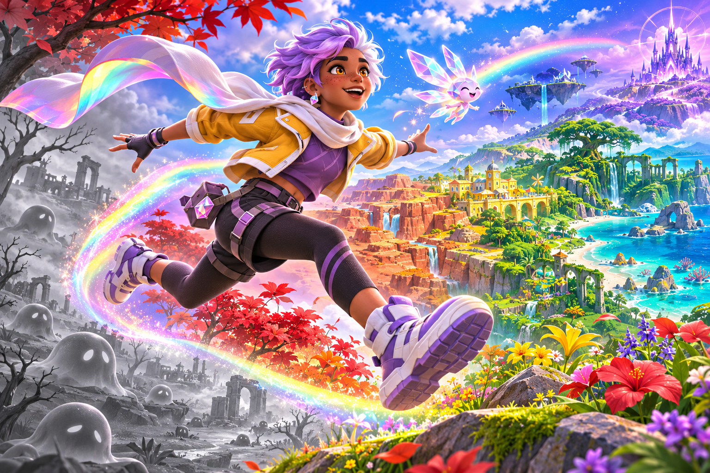
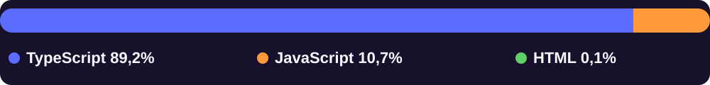
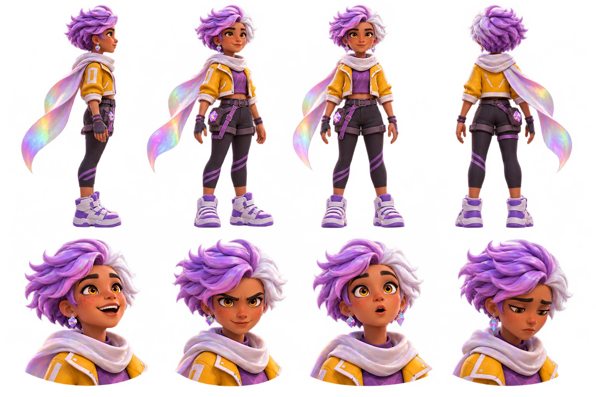
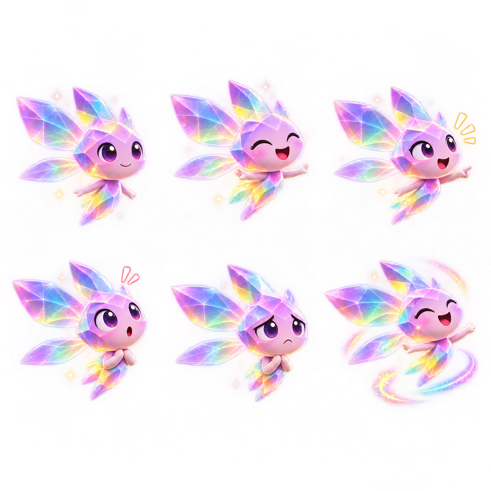
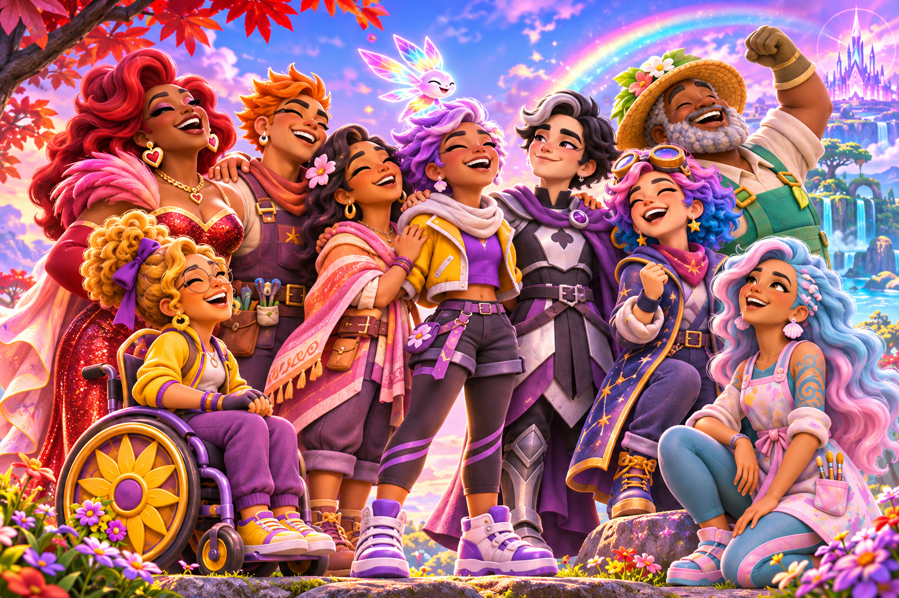
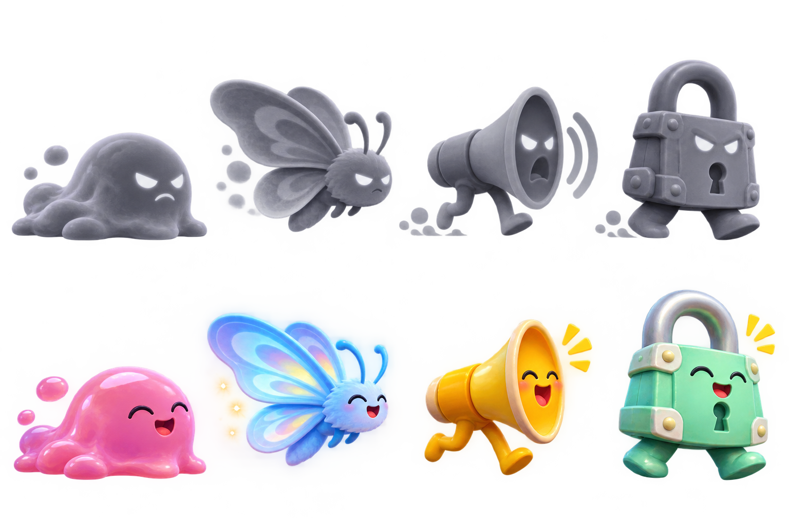
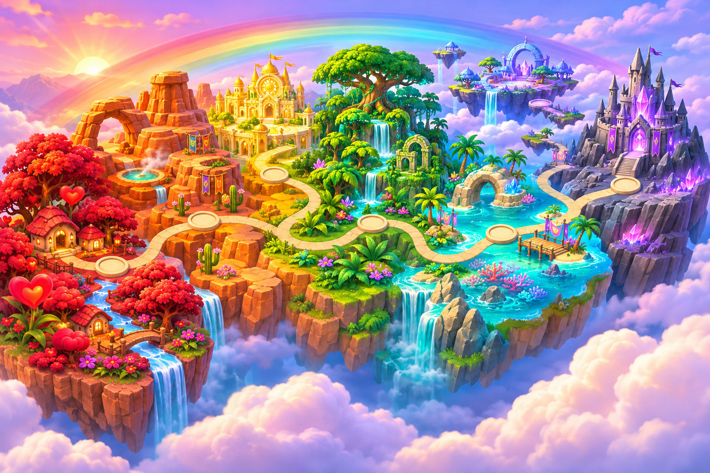

<div align="center">



# PRISMA

### 🌈 Uma aventura de plataforma sobre cor, coragem e pertencimento.

**Sete mundos. Vinte e oito fases. Uma jornada para devolver a cada pessoa o direito de ser quem é.**

[**Jogar no navegador**](https://paulociano.github.io/prisma/) · [**Explorar os mundos**](#os-sete-mundos) · [**Conhecer os personagens**](#personagens) · [**Executar o projeto**](#como-jogar-localmente)

### Linguagens utilizadas



<sub>Participação aproximada por tamanho dos arquivos de código versionados (TypeScript, scripts JavaScript e HTML), sem contar artes, áudio e arquivos gerados. Medição do repositório em 01/11/2026.</sub>

[](https://phaser.io/)
[](https://www.typescriptlang.org/)
[](https://vite.dev/)
[](https://github.com/paulociano/prisma/actions)

</div>

---

## O jogo

**PRISMA** é um jogo de plataforma 2D com visual 3D estilizado, exploração, combate não letal e progressão de habilidades. A aventura atravessa sete regiões inspiradas nas cores do arco-íris. Em cada uma delas, Íris enfrenta desafios, descobre histórias, encontra novos aliados e recupera partes de um mundo que está perdendo suas cores.

A ideia central é simples: **ninguém precisa perder sua identidade para que outra pessoa possa brilhar.** Aqui, os Desbotados não são inimigos a eliminar, mas seres que podem recuperar suas cores.

| Aventura | Conteúdo |
|:--|:--|
| 🌈 Mundos | **7** regiões temáticas |
| 🗺️ Fases | **28**: 21 fases de exploração e 7 encontros com chefões |
| 💎 Fragmentos | **63** fragmentos de prisma para coletar |
| ✨ Progressão | Pulo duplo, dash, pulo na parede, planar, disparo e mergulho estelar |
| 🎮 Controles | Teclado e gamepad |
| 💾 Progresso | Salvo no navegador |
| ♿ Acessibilidade | Dificuldade ajustável, filtros de cor, redução de flashes e tremores, sinais visuais extras |

## A história

Um dia, o mundo de PRISMA começou a desbotar.

Onde antes havia paisagens vibrantes, encontros e diferenças celebradas, surgiram o silêncio e os tons de cinza. Por trás dessa transformação está **Monocromo**, uma presença que tenta apagar aquilo que torna cada ser único.

**Íris**, uma pessoa jovem não binária, parte em busca das cores desaparecidas. Ao lado de **Faísca**, seu pequeno companheiro prismático, percorre vales, cânions, cidades, selvas, recifes e ilhas suspensas. Cada região guarda uma comunidade, uma história e alguém esperando para ser libertado.

O objetivo não é destruir: é **restaurar**. Cada guardião libertado ajuda Íris a crescer, e cada nova habilidade abre possibilidades para seguir viagem. Ao reunir todos os fragmentos, uma conclusão especial pode ser descoberta.

> **PRISMA é uma história sobre diversidade, amizade, acolhimento e a liberdade de existir em todas as nossas cores.**

## Personagens

<table>
<tr>
<td width="50%" align="center">

<br/><strong>Íris</strong>
<br/>Protagonista da aventura. Determinação, curiosidade e uma echarpe especial conduzem sua jornada pelas sete regiões.
</td>
<td width="50%" align="center">

<br/><strong>Faísca</strong>
<br/>Uma pequena luz de companhia, orientação e esperança. Viaja com Íris e ajuda a lembrar que nenhuma cor precisa caminhar sozinha.
</td>
</tr>
</table>

### Os guardiões

<div align="center">

</div>

Os guardiões personificam diferentes vivências, maneiras de cuidar e formas de pertencimento. O reencontro com cada um marca um passo na restauração de PRISMA.

| Região | Guardião ou guardiãs | O encontro |
|:--|:--|:--|
| ❤️ Vale do Coração | **Mãe Rubi** | Uma figura acolhedora, exuberante e corajosa |
| 🧡 Cânion do Entardecer | **Sol e Luna** | Uma parceria de cuidado, escuta e cura |
| 💛 Cidade Solar | **Aurora** | Liderança, autonomia e presença |
| 💚 Selva Esmeralda | **Ramo** | Cultivo, comunidade e conexão com a natureza |
| 🩵 Recife Turquesa | **Marina** | Criatividade, fluidez e expressão |
| 💙 Ilhas do Céu Anil | **Bix** | Descoberta, imaginação e novas perspectivas |
| 💜 Cidadela Cinza | **Ás** | Coragem para existir com autenticidade |

### Os Desbotados e Monocromo

<div align="center">

</div>

As criaturas afetadas pelo desbotamento representam o que acontece quando a diversidade é apagada. **Monocromo** é a força por trás dessa perda de cor. O sistema de jogo enfatiza restauração, não eliminação.

## Os sete mundos

<div align="center">

</div>

| Mundo | Região | Identidade visual |
|:--:|:--|:--|
| 01 | ❤️ **Vale do Coração** | Colinas vermelhas, casas acolhedoras e flores |
| 02 | 🧡 **Cânion do Entardecer** | Rochas alaranjadas, arcos e águas termais |
| 03 | 💛 **Cidade Solar** | Telhados ensolarados, girassóis e festivais |
| 04 | 💚 **Selva Esmeralda** | Árvores gigantes, cachoeiras e ruínas verdes |
| 05 | 🩵 **Recife Turquesa** | Corais, esculturas submersas e vida marinha |
| 06 | 💙 **Ilhas do Céu Anil** | Ilhas flutuantes, estrelas e observatórios |
| 07 | 💜 **Cidadela Cinza** | Uma fortaleza desbotada à espera das cores |

## Próximas melhorias

O plano de desenvolvimento atualizado, com prioridades, critérios de aceite e verificações de QA, está em **[docs/ROADMAP.md](docs/ROADMAP.md)**.

## Como jogar localmente

Requer Node.js (versão LTS).

```bash
npm install
npm run assets
npm run dev
```

O servidor de desenvolvimento abre em `http://localhost:5173`.

| Comando | O que faz |
|:--|:--|
| `npm run assets` | Processa artes, sprites e áudio de `assets/` para `public/assets/` |
| `npm run dev` | Inicia o jogo em modo de desenvolvimento |
| `npm run build` | Compila a versão de produção em `dist/` |
| `npm run check-levels` | Verifica, por simulação, a alcançabilidade das fases |
| `npm run test:save` | Testa a persistência de progresso |
| `npm run test:input` | Testa o tratamento do analógico |

### Controles

| Ação | Teclado |
|:--|:--|
| Mover | `←` `→` ou `A` `D` |
| Pular | `Espaço` / `Z` |
| Golpe de echarpe | `X` |
| Disparo prismático | `C` |
| Dash | `Shift` |
| Mergulho estelar | `↓` no ar |
| Pausar | `Esc` |
| Som | `M` |

As habilidades são liberadas ao longo da aventura.

### Acessibilidade

Em **Opções** é possível escolher a dificuldade, configurar modos de correção de cor e ativar independentemente **redução de flashes**, **redução de tremores** e **sinais visuais extras**. As preferências ficam separadas do progresso da campanha.

## Estrutura técnica

| Pasta | Conteúdo |
|:--|:--|
| `assets/` | Imagens originais, sprites, cenários e sons |
| `src/levels/` | Definições de fases e gerador de trechos adicionais |
| `src/objects/` | Íris, criaturas e chefões |
| `src/scenes/` | Título, mapas, gameplay, HUD, diálogos e cutscenes |
| `src/systems/` | Controles, áudio, save, acessibilidade e restauração de cor |
| `scripts/` | Pipeline de assets e verificadores |
| `docs/` | Material do projeto e documentação |

## Publicação no GitHub Pages

O workflow `.github/workflows/deploy-pages.yml` gera os assets, executa o build e publica a pasta `dist/` após alterações na branch `main`.

Para ativar, selecione **Settings → Pages → Build and deployment → Source: GitHub Actions**. A publicação pode ser acompanhada na aba [Actions](https://github.com/paulociano/prisma/actions/workflows/deploy-pages.yml).

**Endereço esperado após deploy bem-sucedido:** https://paulociano.github.io/prisma/

O progresso fica no armazenamento local do navegador e não é transferido automaticamente entre dispositivos ou domínios.

---

<div align="center">

**Toda cor conta. Toda história importa.**

*PRISMA · Uma aventura sobre enxergar o mundo em todas as suas cores.*

</div>
